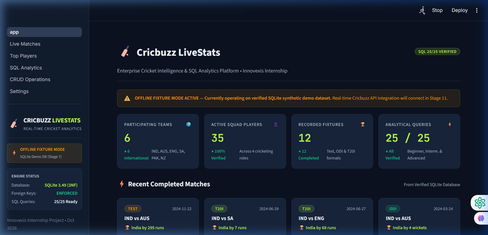
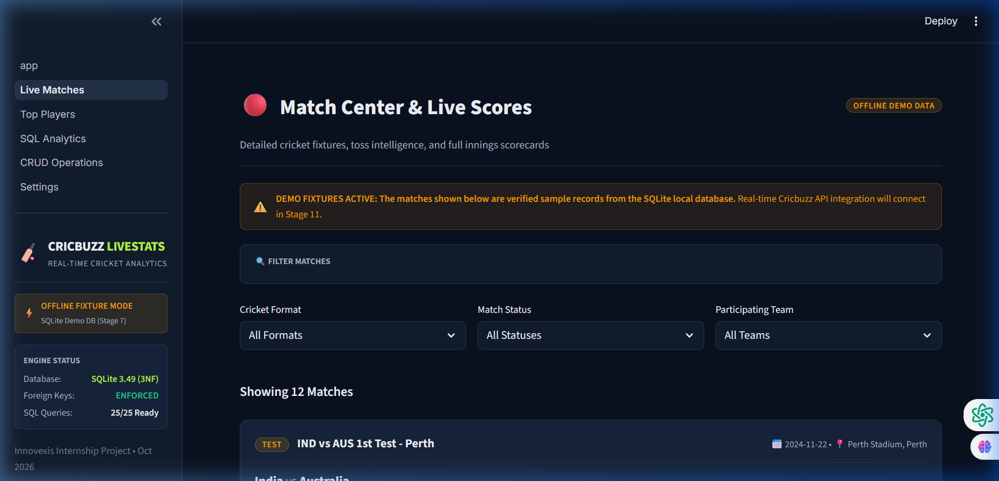
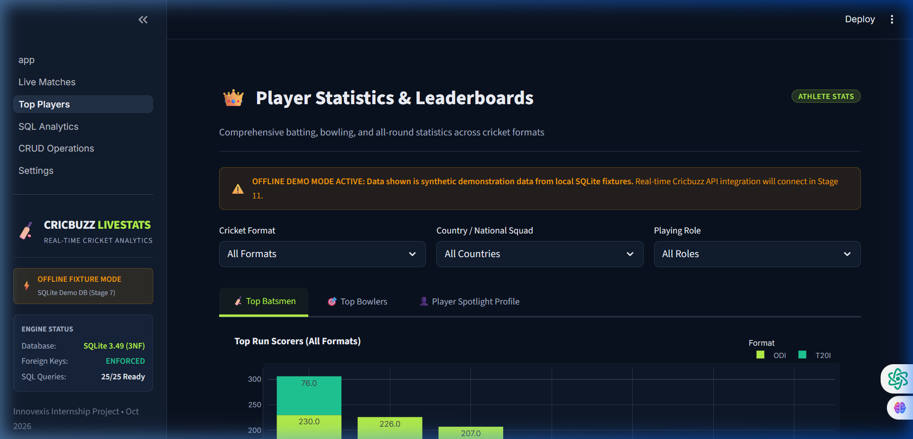
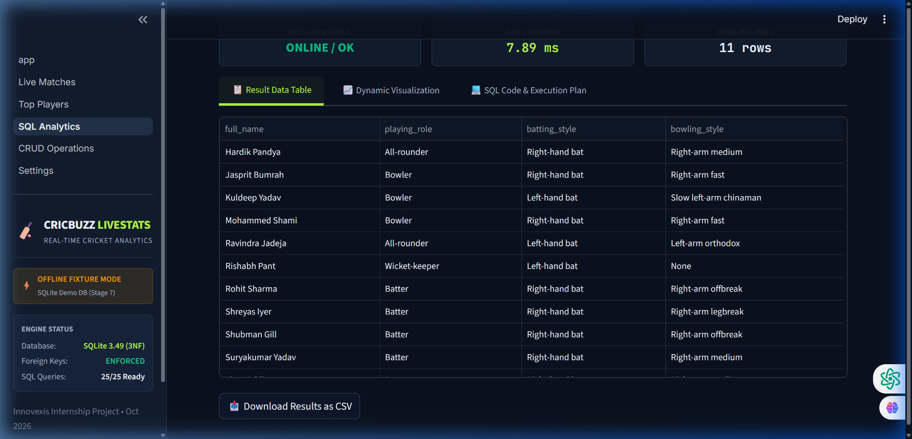
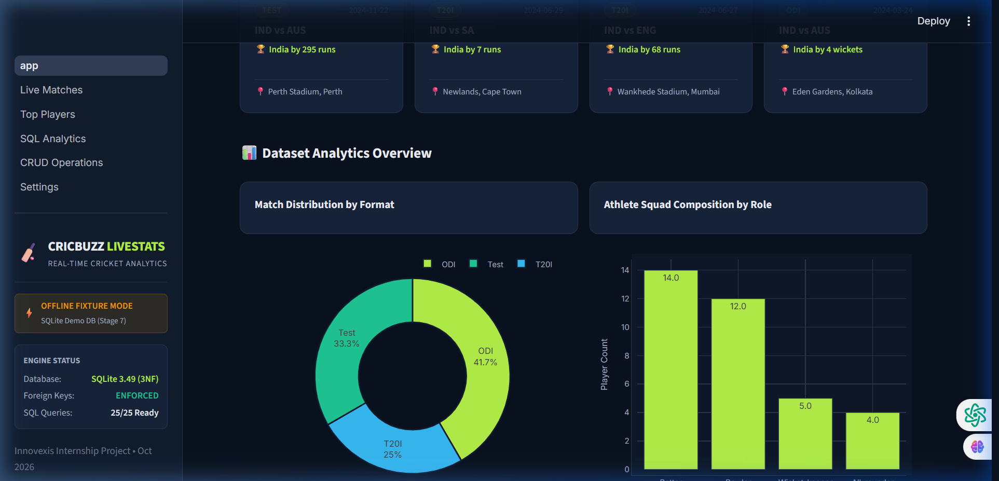

# Cricbuzz LiveStats — Real-Time Cricket Insights & SQL-Based Analytics

[](https://www.python.org/)
[](https://www.sqlite.org/)
[](https://streamlit.io/)
[](https://plotly.com/)
[-success?logo=pytest&logoColor=white)](tests/)
[](config.py)
[]()

> **A professional cricket analytics platform and SQL query demonstration dashboard inspired by Cricbuzz. Built with Python, SQLite, and Streamlit, featuring a broadcast-grade Midnight Navy & Electric Lime interface, a normalized 10-table relational schema, 5 analytical views, 25 cataloged SQL questions, parameterized CRUD services, and 109 automated tests.**

---

## Table of Contents
1. [Project Overview & Problem Statement](#project-overview--problem-statement)
2. [Visual Design & User Interface](#visual-design--user-interface)
3. [Key Features & Capabilities](#key-features--capabilities)
4. [Technology Stack & Prerequisites](#technology-stack--prerequisites)
5. [Directory Structure](#directory-structure)
6. [Installation & Quick Start](#installation--quick-start)
7. [Database Schema & Architecture](#database-schema--architecture)
8. [The 25 SQL Analytical Queries](#the-25-sql-analytical-queries)
9. [Automated Testing & Quality Assurance](#automated-testing--quality-assurance)
10. [Data Honesty, Limitations & API Roadmap](#data-honesty-limitations--api-roadmap)
11. [Author & Academic Attribution](#author--academic-attribution)

---

## Project Overview & Problem Statement

Cricket is one of the world's most data-rich sports, producing multidimensional statistics across formats (Test, ODI, T20I), innings, partnerships, overs, dismissals, and venue conditions. While commercial platforms like Cricbuzz deliver live coverage to millions of fans, students and analysts often lack an accessible, fully open, and relational platform to practice complex analytical SQL queries against authentic cricket data models.

**Cricbuzz LiveStats** bridges this gap:
- **Normalized Relational Modeling:** Replaces flat files or loose spreadsheets with a 3NF SQLite schema enforcing referential integrity, foreign key cascades, domain `CHECK` constraints, and unique compound keys.
- **SQL Analytics Showcase:** Implements and verifies **all 25 real-world analytical questions** (from foundational squad filters to complex window functions, career form momentum curves, and standard deviation consistency).
- **Broadcast-Grade UI:** Delivers a modern dark-mode sports analytics interface built in Streamlit and Plotly, styled in **Midnight Navy (`#0B1220`)** and **Electric Lime (`#B7F34A`)**.
- **Transactional CRUD Layer:** Offers safe, parameterized management of players, venues, and fixtures with input validators, foreign-key protection, soft deletion, and API-source segregation.
- **Data Honesty:** Operates in `OFFLINE_MODE = True` with an internally consistent 12-match demonstration dataset, transparently distinguishing demo records from live API streams.

---

## Visual Design & User Interface

The application adheres to an executive broadcast theme:

| Page | Description | Verified Visual Preview |
| :--- | :--- | :---: |
| **Home Dashboard** (`app.py`) | High-level metrics, active fixtures, format donut distribution, team participation, and architecture blueprint |  |
| **Live Matches** (`pages/1_Live_Matches.py`) | Match Center with format/status/team filters, match cards, and expandable full-innings scorecards |  |
| **Top Players** (`pages/2_Top_Players.py`) | Batting & Bowling leaderboards, format segmentation (All/Test/ODI/T20I), and Athlete Spotlight |  |
| **SQL Analytics** (`pages/3_SQL_Analytics.py`) | Interactive SQL runner for all 25 questions with execution timings, data tables, CSV exports, and `EXPLAIN QUERY PLAN` |  |
| **CRUD Operations** (`pages/4_CRUD_Operations.py`) | Management console for Players, Venues, and Matches with validation and referential protection |  |
| **Settings & Diagnostics** (`pages/5_Settings.py`) | SQLite engine telemetry (`integrity_check`, `foreign_keys`), table row counts, environment info, and sample re-seeder |  |

---

## Key Features & Capabilities

- **Strict Relational Integrity:** Enforces `PRAGMA foreign_keys = ON` on every connection via a thread-safe connection manager.
- **Mathematically Accurate Cricket Logic:**
  - True overs calculated from balls bowled (`balls / 6 + (balls % 6) / 10.0`), avoiding decimal notation flaws.
  - Batting average calculated per dismissal (`NULLIF(innings - not_outs, 0)`), preventing division by zero.
  - Strike rates and bowling economy rates calculated to 2 decimal places.
- **Anti-Cartesian Analytical Views:** Views such as `v_player_career_totals` isolate batting and bowling aggregations into separate subqueries before joining, eliminating duplicate row multiplication.
- **Safe Query Execution:** SQL Analytics runs approved parameterized SQL files with whitelisted execution; no arbitrary user-entered SQL is evaluated.
- **Safe Data Mutations:** CRUD services prevent accidental deletion of players with recorded performances, while allowing soft deletion toggles (`is_active = 0`) and unreferenced hard deletes.
- **Offline Integrity & Idempotency:** Seeding scripts can be run repeatedly without duplicating records or corrupting sequences.

---

## Technology Stack & Prerequisites

### Core Technologies
- **Python 3.10+** (Tested on Python 3.13.7)
- **SQLite 3.49+** (Embedded ACID relational database engine)
- **Streamlit 1.47+** (Interactive multi-page web application framework)
- **Plotly 7.1+** (Interactive responsive charting library)
- **Pandas 2.2+** (DataFrame manipulation and tabular presentation)
- **pytest 9.1+** (Automated unit, integration, and UI testing)

### Hardware Requirements
- **RAM:** Minimum 2 GB (4 GB recommended)
- **Disk:** 100 MB free space
- **OS:** Windows 10/11, macOS 12+, or Ubuntu 20.04+ Linux

---

## Directory Structure

```text
Cricbuzz/
├── app.py                      # Application entry point: Home Dashboard
├── config.py                   # Central configuration, paths, and OFFLINE_MODE flag
├── requirements.txt            # Locked Python production and test dependencies
├── .env.example                # Template environment variables file
├── .gitignore                  # Git exclusions for venv, databases, and logs
│
├── analytics/                  # SQL execution and query runner layer
│   ├── __init__.py
│   └── query_runner.py         # Whitelisted query executor, timer, and catalog
│
├── api/                        # Future API integration scaffolding (Stage 11)
│   ├── __init__.py
│   └── cricbuzz_client.py      # Abstract API client definition
│
├── assets/                     # Static media and documentation images
│   └── screenshots/            # Verified application interface captures
│
├── data/                       # Local offline fixtures and SQLite database
│   ├── cricbuzz.db             # Primary SQLite database file (12 matches, 35 players)
│   ├── seed_data.py            # Idempotent database population script
│   └── fixtures/
│       └── sample_matches.json # Structured offline demonstration fixture data
│
├── database/                   # Database connection manager and schema initialization
│   ├── __init__.py
│   ├── connection.py           # Context-managed connection pool with PRAGMA foreign_keys = ON
│   └── init_db.py              # Fresh DB setup, integrity verification, and validation CLI
│
├── docs/                       # Project engineering documentation & architecture records
│   ├── ARCHITECTURE.md         # Layered architectural blueprint and invariants
│   ├── DECISIONS.md            # Architecture Decision Records (ADR-001 through ADR-007)
│   ├── DESIGN.md               # Visual theme, typography, and component styling rules
│   ├── MEMORY.md               # Cumulative implementation log and stage history
│   ├── PRD.md                  # Product Requirements Document
│   ├── RULES.md                # Engineering constraints and testing guidelines
│   └── TASKS.md                # Master stage-by-stage implementation checklist
│
├── documentation/              # Operations and academic interview guides
│   ├── DEPLOYMENT.md           # Local & cloud deployment runbook and troubleshooting
│   └── INTERVIEW_PREP.md       # 50-Question Technical Viva & System Design Guide
│
├── logs/                       # Application logs directory
│   └── app.log                 # Rotating runtime log file (5 MB, 3 backups)
│
├── pages/                      # Streamlit multi-page interface definitions
│   ├── 1_Live_Matches.py       # Match Center with format/status filters & scorecards
│   ├── 2_Top_Players.py        # Batting & Bowling leaderboards and player spotlight
│   ├── 3_SQL_Analytics.py      # 25-Question SQL analytical playground & chart visualizer
│   ├── 4_CRUD_Operations.py    # Form-based player, venue, and match management
│   └── 5_Settings.py           # Database telemetry, diagnostics, and sample re-seeder
│
├── sql/                        # Relational DDL, views, indexes, and analytical queries
│   ├── schema.sql              # Normalized 10-table relational schema with CHECK constraints
│   ├── views.sql               # 5 analytical views (career totals, match details, summaries)
│   └── queries/                # Approved SQL implementations for Questions 1 through 25
│       ├── q01.sql             # India players roster
│       ├── q02.sql             # Matches in last 30 days
│       ├── ...
│       └── q25.sql             # Career quarterly performance trajectories
│
├── tests/                      # Automated pytest validation suite (109 tests)
│   ├── test_crud.py            # CRUD operations, domain validators, and rollbacks
│   ├── test_database.py        # Relational schema, constraints, cascades, and FK pragma
│   ├── test_init_db.py         # Initialization idempotency, verification, and overs math
│   ├── test_queries.py         # Analytical queries Q03-Q25 and volume fixtures
│   ├── test_query_runner.py    # Catalog integrity, DataFrame output, and cp1252 cleanliness
│   ├── test_seed_data.py       # Seed data integrity, idempotency, and scenario coverage
│   ├── test_ui.py              # Streamlit AppTest headless execution and chart helpers
│   └── test_workflows.py       # 6 realistic end-to-end operational workflows
│
└── utils/                      # Shared helper utilities
    ├── __init__.py
    ├── charts.py               # Plotly chart creation with midnight-lime styling
    ├── logger.py               # Standard rotating file and console logger
    ├── theme.py                # CSS injection, KPI cards, badges, and banners
    └── validators.py           # Domain payload validators for players, venues, and matches
```

---

## Installation & Quick Start

### 1. Clone or Open the Repository
```bash
git clone https://github.com/your-username/Cricbuzz.git
cd Cricbuzz
```

### 2. Create and Activate a Virtual Environment
```bash
# Windows (PowerShell)
python -m venv venv
.\venv\Scripts\Activate.ps1

# macOS / Linux (bash/zsh)
python3 -m venv venv
source venv/bin/activate
```

### 3. Install Dependencies
```bash
pip install --upgrade pip
pip install -r requirements.txt
```

### 4. Initialize Database & Seed Demo Fixtures
```bash
# Initialize schema, indexes, and analytical views
python -m database.init_db

# Populate database with offline demonstration fixtures (idempotent)
python -m data.seed_data
```

### 5. Launch the Streamlit Web Application
```bash
streamlit run app.py
```
Open your browser to `http://localhost:8501`.

---

## Database Schema & Architecture

The database is built on a 3NF normalized relational model across 10 tables:

```
    +-------------------+       +-------------------+
    |      SERIES       |       |      VENUES       |
    +-------------------+       +-------------------+
    | series_id (PK)    |       | venue_id (PK)     |
    | series_name       |       | venue_name        |
    | host_country      |       | city, country     |
    +---------+---------+       | capacity          |
              |                 +---------+---------+
              | 1:N                       | 1:N
              v                           v
+---------------------------------------------------+
|                      MATCHES                      |
+---------------------------------------------------+
| match_id (PK), series_id (FK), venue_id (FK)      |
| team1_id (FK), team2_id (FK), match_format        |
| match_date, toss_winner_id (FK), match_status     |
| winning_team_id (FK), win_margin, win_type, source|
+-------------------------+-------------------------+
                          | 1:N
                          v
+---------------------------------------------------+
|                      INNINGS                      |
+---------------------------------------------------+
| innings_id (PK), match_id (FK), innings_number    |
| batting_team_id (FK), bowling_team_id (FK)        |
| total_runs, total_wickets, overs_completed        |
+------------+--------------------+-----------------+
             |                    |
         1:N |                1:N |
             v                    v
+-----------------------+  +------------------------+
|  BATTING_PERFORMANCES |  |  BOWLING_PERFORMANCES  |
+-----------------------+  +------------------------+
| perf_id (PK)          |  | bowl_id (PK)           |
| innings_id (FK)       |  | innings_id (FK)        |
| player_id (FK)        |  | player_id (FK)         |
| batting_position      |  | overs_bowled           |
| runs_scored           |  | balls_bowled           |
| balls_faced           |  | maidens, runs_conceded |
| fours, sixes          |  | wickets_taken, economy |
| dismissal_type        |  +------------------------+
+-----------------------+
```

### Summary of Tables
1. **`teams`**: Participating national sides (India, Australia, England, South Africa, etc.).
2. **`players`**: Athlete rosters with country, playing role, batting style, and bowling style.
3. **`venues`**: Cricket grounds with city, country, and verified seating capacity.
4. **`series`**: Tournaments, bilateral tours, and multi-match series.
5. **`matches`**: Fixtures with participating teams, venue, date, format, and outcome.
6. **`innings`**: Inning-by-inning team totals (runs, wickets, overs completed).
7. **`batting_performances`**: Individual batsman scorecards (runs, balls, 4s, 6s, dismissal).
8. **`bowling_performances`**: Individual bowler scorecards (balls, maidens, runs, wickets).
9. **`fielding_performances`**: Catches, run outs, and stumpings credited to fielders.
10. **`partnerships`**: Batting partnership stands per wicket.

### Analytical Views
- **`v_match_details`**: Flattens match, venue, series, team names, and victory summaries.
- **`v_innings_summary`**: Summarizes team totals, run rates, and declaration states.
- **`v_player_batting_by_format`**: Aggregates runs, balls, boundaries, and batting average per format.
- **`v_player_bowling_by_format`**: Aggregates overs, wickets, runs conceded, and economy rate per format.
- **`v_player_career_totals`**: Anti-Cartesian joined career summary combining batting and bowling without inflated sums.

---

## The 25 SQL Analytical Queries

The platform includes verified implementations for all 25 queries specified in `Cricbuzz.docx`:

| # | Question Title | Difficulty | SQL Concepts Applied |
| :-: | :--- | :-: | :--- |
| **Q01** | India Players Roster | Beginner | Column projection, `WHERE` filtering, `COALESCE` |
| **Q02** | Matches in Last 30 Days | Beginner | Date filtering, `DATE('now', '-30 days')`, joins |
| **Q03** | Top 10 ODI Run Scorers | Beginner | Aggregation, `SUM`, `ORDER BY DESC LIMIT 10`, average calculation |
| **Q04** | Large Venues (>50,000 Capacity) | Beginner | Integer filtering, `WHERE capacity > 50000`, sorting |
| **Q05** | Team Wins Summary | Beginner | Outer join, `COUNT(winning_team_id)`, zero-win handling |
| **Q06** | Player Counts by Role | Beginner | `GROUP BY playing_role`, categorical aggregation |
| **Q07** | Highest Individual Score by Format | Beginner | Subqueries, partition by format, max runs extraction |
| **Q08** | Series Started in 2024 | Beginner | `strftime('%Y', start_date) = '2024'`, date projection |
| **Q09** | All-rounders (>1,000 Runs & >50 Wkts) | Intermediate | Having clause, multi-table career joins, thresholds |
| **Q10** | Last 20 Completed Matches & Margins | Intermediate | Order by date descending, margin formatting, limit 20 |
| **Q11** | Cross-Format Player Performance | Intermediate | Conditional aggregation, `CASE WHEN`, cross-format averages |
| **Q12** | Home vs Away Performance | Intermediate | Country comparisons (`venue.country = team.country`) |
| **Q13** | Consecutive Batting Pairs (Sum >= 100) | Intermediate | Self-join on `batting_position = batting_position + 1` |
| **Q14** | Venue Bowling Analysis | Intermediate | Multi-match venue filtering, bowling economy averages |
| **Q15** | Players in Close Matches | Intermediate | Narrow victory margins (`win_margin < 50` or `< 5 wkts`) |
| **Q16** | Yearly Batting Trends Since 2020 | Intermediate | Year extraction, yearly weighted strike rates, minimum match filter |
| **Q17** | Toss Advantage Analysis | Advanced | Conditional success rates, bat vs bowl win percentages |
| **Q18** | Economical Limited-Overs Bowlers | Advanced | True overs math, `balls_bowled`, white-ball format filter |
| **Q19** | Batting Consistency (Standard Deviation) | Advanced | Sample variance formula, square root approximation in SQL |
| **Q20** | Matches & Averages by Format (>= 20) | Advanced | Volume threshold filtering, multi-format pivot representation |
| **Q21** | Weighted Player Ranking (PENDING REVIEW) | Advanced | Batting/bowling/fielding metrics (Composite formula held per ADR-005) |
| **Q22** | Team Head-to-Head Analysis | Advanced | Bi-directional team pair normalization (`LEAST`/`GREATEST`) |
| **Q23** | Recent Player Form & Momentum | Advanced | Window functions (`ROW_NUMBER() OVER`), last 5 vs last 10 trend |
| **Q24** | Batting Partnerships Analysis | Advanced | Pair normalization, 50+ stand counting, stand averages |
| **Q25** | Quarterly Career Trajectory | Advanced | Time-series career quarters, progressive strike rate tracking |

---

## Automated Testing & Quality Assurance

The codebase is backed by **109 automated tests** with 100% pass rate:

```bash
python -m pytest -v
```

### Test Suite Organization
1. **`tests/test_database.py` (9 tests):** Schema creation, view integrity, foreign-key enforcement (`PRAGMA foreign_keys = ON`), domain constraints, cascade safety.
2. **`tests/test_init_db.py` (7 tests):** Safe database initialization, idempotency, overs math verification, and schema validation.
3. **`tests/test_seed_data.py` (4 tests):** Seed data population, referential consistency, JSON fixture schema validation.
4. **`tests/test_crud.py` (30 tests):** Parameterized CRUD, validators, duplicate rejection, soft-deletion, foreign-key protection, atomic rollbacks.
5. **`tests/test_queries.py` (23 tests):** Validates all analytical queries Q03–Q25, standard deviation math, fractional overs logic, and isolated volume fixtures.
6. **`tests/test_query_runner.py` (13 tests):** Catalog integrity, DataFrame conversions, `EXPLAIN QUERY PLAN`, and Windows `cp1252` encoding safety.
7. **`tests/test_ui.py` (17 tests):** Headless AppTest execution across all 6 pages, theme components, and Plotly chart title sanitization.
8. **`tests/test_workflows.py` (6 tests):** Real-world end-to-end multi-step operational workflows against isolated temporary databases.

---

## Data Honesty, Limitations & API Roadmap

### Data Honesty Policy
- **Synthetic Demonstration Fixtures:** All currently seeded matches, scorecards, and player statistics represent locally generated demo data with `source = 'LOCAL'`. They are not presented as live internet broadcasts.
- **Q21 Governance (ADR-005):** Question 21's composite ranking scoring formula remains strictly marked `PENDING REVIEW`. No arbitrary formula has been invented.
- **Offline Configuration:** The application defaults to `OFFLINE_MODE = True`. No unexpected internet calls or broken requests occur.

### Known Limitations
- **Threshold Queries on Sample DB:** 9 queries return 0 rows on the standard 12-match sample database because they require historical sample sizes (e.g., $\ge 10$ or $\ge 20$ matches). All 9 queries are proven working via isolated volume test fixtures in `tests/test_queries.py`.
- **Single-Writer SQLite:** While SQLite supports unlimited concurrent readers, concurrent high-volume writes require careful timeout management.

### Stage 11 API Integration Roadmap
When real Cricbuzz API access (e.g. via RapidAPI) is integrated in Stage 11:
1. Store credentials securely in `.env` (`RAPIDAPI_KEY`).
2. Implement `api/cricbuzz_client.py` with exponential backoff and rate limit caching.
3. Ingest live responses into `matches`, `innings`, and performance tables with `source = 'API'`.
4. Maintain dual-mode switching via `OFFLINE_MODE` flag.

---

## Author & Academic Attribution
- **Project:** Cricbuzz LiveStats — Real-Time Cricket Insights & SQL-Based Analytics
- **Primary Use Case:** Advanced Database Systems, SQL Analytics Portfolio & Software Engineering Capstone
- **Architecture Guidelines:** Documented in [docs/ARCHITECTURE.md](docs/ARCHITECTURE.md) and [docs/DECISIONS.md](docs/DECISIONS.md)
